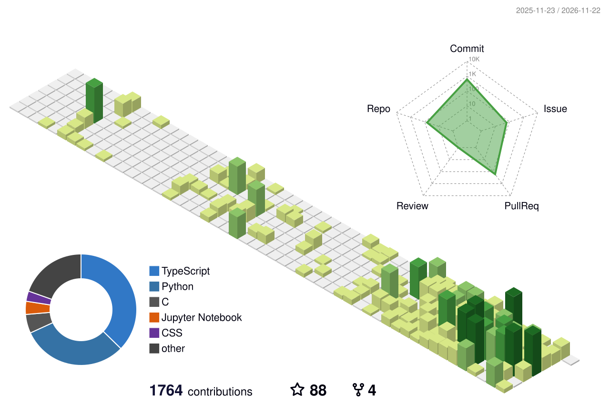

### About Me

- **ML / DL / LLM**
- **CS Specialist** at the **University of Toronto**.
- **Knowledge is Human**.
- **UofT** [@Guancheng-Chen](https://github.com/Guancheng-Chen)

---

### Technical stack

| Category | Skills & Technologies |
| :--- | :--- |
| **Primary Languages** |      |
| **Systems & Low-Level** |     |
| **AI, ML & Agentic Systems** |         |
| **Frontend** |     |
| **Backend & Databases** |      |
| **Cloud, DevOps & Tools** |       |

---

### Github Contributions

<div align="center">
  <picture>
    <source media="(prefers-color-scheme: dark)" srcset="https://raw.githubusercontent.com/austinchennn/austinchennn/output/github-contribution-grid-snake-dark.svg">
    <source media="(prefers-color-scheme: light)" srcset="https://raw.githubusercontent.com/austinchennn/austinchennn/output/github-contribution-grid-snake.svg">
    
  </picture>
  
  <br/>
  
  <picture>
    <source media="(prefers-color-scheme: dark)" srcset="profile-3d-contrib/profile-night-view.svg">
    <source media="(prefers-color-scheme: light)" srcset="profile-3d-contrib/profile-green-animate.svg">
    
  </picture>
</div>

---

### Coding Activity

<!--START_SECTION:waka-->

```txt
Other        17 hrs 26 mins        ⣿⣿⣿⣿⣿⣿⣦⣀⣀⣀⣀⣀⣀⣀⣀⣀⣀⣀⣀⣀⣀⣀⣀⣀⣀   25.84 %
Markdown     16 hrs 14 mins        ⣿⣿⣿⣿⣿⣿⣀⣀⣀⣀⣀⣀⣀⣀⣀⣀⣀⣀⣀⣀⣀⣀⣀⣀⣀   24.05 %
TypeScript   11 hrs 54 mins        ⣿⣿⣿⣿⣤⣀⣀⣀⣀⣀⣀⣀⣀⣀⣀⣀⣀⣀⣀⣀⣀⣀⣀⣀⣀   17.64 %
Python       8 hrs 10 mins         ⣿⣿⣿⣀⣀⣀⣀⣀⣀⣀⣀⣀⣀⣀⣀⣀⣀⣀⣀⣀⣀⣀⣀⣀⣀   12.10 %
TeX          7 hrs                 ⣿⣿⣶⣀⣀⣀⣀⣀⣀⣀⣀⣀⣀⣀⣀⣀⣀⣀⣀⣀⣀⣀⣀⣀⣀   10.39 %
```

<!--END_SECTION:waka-->


---

### Open Source Contributions

  

| Project | Merged PR | Date | What changed |
| :--- | :--- | :--- | :--- |
| [**gptme/gptme**](https://github.com/gptme/gptme)  | [#4885](https://github.com/gptme/gptme/pull/4885) fix(storage): hash copied attachment bytes before publishing | 2026-11-13 | Terminal AI agent: content-addressed attachment cache now hashes the bytes actually copied, so concurrent source edits can't mismatch name and content. |
| [**shibing624/agentica**](https://github.com/shibing624/agentica)  | [#44](https://github.com/shibing624/agentica/pull/44) fix: honor CSV row limits before parsing later records | 2026-11-14 | Agent SDK: CSV parser consumes only the requested prefix, so malformed later rows no longer discard valid ones. |
| [**stumpy-dev/stumpy**](https://github.com/stumpy-dev/stumpy)  | [#1221](https://github.com/stumpy-dev/stumpy/pull/1221) Migrate tests/test_snippets.py to npt.assert_allclose | 2026-11-14 | Matrix-profile library: 28 float assertions migrated; full test suite and 100% coverage re-run locally. |
| [**stumpy-dev/stumpy**](https://github.com/stumpy-dev/stumpy)  | [#1222](https://github.com/stumpy-dev/stumpy/pull/1222) Migrate STIMP tests to assert_allclose | 2026-11-14 | Follow-up test maintenance on the PAN/STIMP tests, invited after #1221 merged. |
| [**aeon-toolkit/aeon**](https://github.com/aeon-toolkit/aeon)  | [#4021](https://github.com/aeon-toolkit/aeon/pull/4021) [DOC] Describe actual clusterer tolerance criteria | 2026-11-14 | Time-series ML toolkit: six clusterer `tol` docstrings now describe the real stopping criteria; defaults unchanged. |
| [**himanshu748/omnidev**](https://github.com/himanshu748/omnidev)  | [#29](https://github.com/himanshu748/omnidev/pull/29) chore(mcp): migrate server and marketplace to SDK v2 | 2026-11-15 | Local-first macOS agent cockpit: MCP SDK v2 migration, tool contracts preserved; `make test` 370 passed. |

<sub>Only PRs verified as merged on GitHub are listed.</sub>
